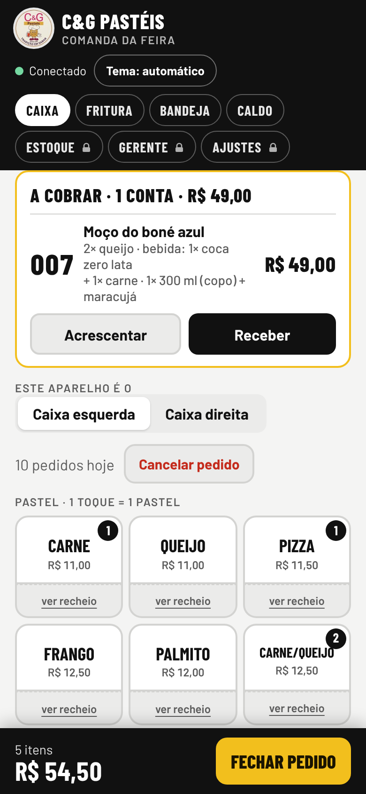
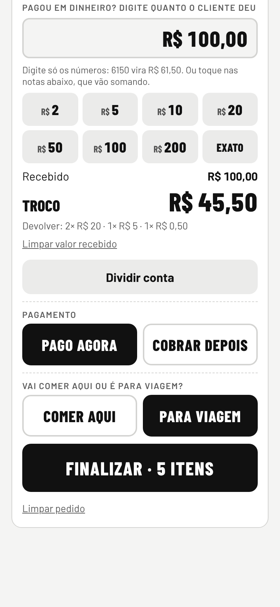
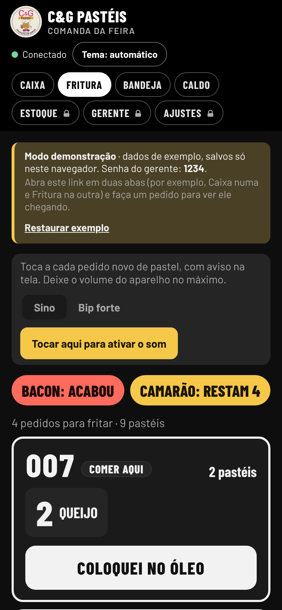
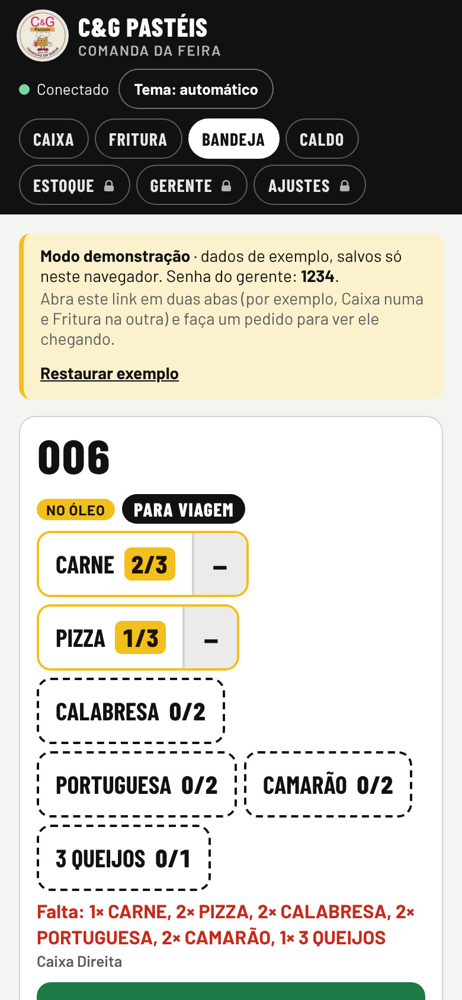
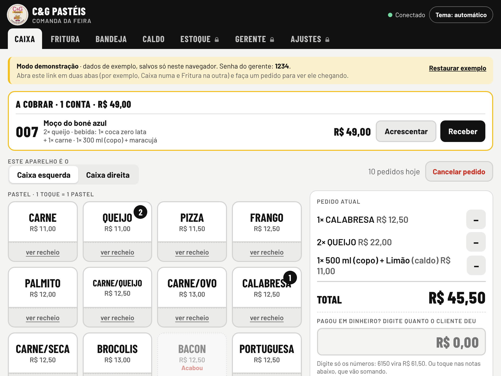
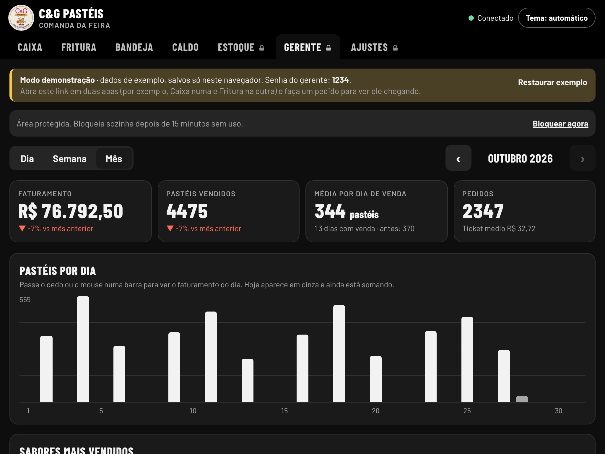

# Comanda da Feira · C&G Pastéis

Sistema de comandas em tempo real para uma barraca de pastel e caldo de cana em feira livre. Os dois caixas lançam os pedidos no celular, e cada posto (fritura, bandeja e caldo) recebe na hora, no seu tablet, só a parte que é dele. Inclui estoque por feira, contas a cobrar, cancelamento e relatórios para o gerente.

**▶ [Abrir a demonstração](https://erickabee.github.io/comanda-feira/)**: abre direto, sem login, com uma feira de exemplo acontecendo. Um **roteiro de 1 minuto** guia pelos quatro postos (caixa → fritura → bandeja → gerente) e marca cada passo sozinho conforme você usa. Para ver o tempo real, abra o link em duas abas (o Caixa numa e a Fritura na outra) e faça um pedido. Se quiser testar do zero, use **"Começar com a feira vazia"**. A senha do gerente na demonstração é **1234**.


| Caixa no celular | Fechando o pedido | Fritura | Bandeja |
|---|---|---|---|
|  |  |  |  |

| Caixa no tablet | Relatório do mês |
|---|---|
|  |  |

## O problema

A barraca trabalha com dois caixas, uma pessoa fritando, uma na bandeja (que entrega pastel e refrigerante) e uma no caldo de cana. Antes, tudo era feito com fichas de papel. Em feira cheia, isso trazia alguns problemas:

- Os dois caixas usavam blocos de fichas diferentes, e os números se misturavam.
- Quem fritava perdia a conta do que já tinha ido para o óleo.
- A bandeja entregava pedidos incompletos, com um pastel faltando.
- O troco era calculado de cabeça, e a conta dividida entre amigos dava confusão.
- No fim do dia, ninguém sabia quanto entrou em dinheiro e quanto no Pix, nem o que mais vendeu.

## O que o sistema faz

| Posto | O que tem |
|---|---|
| **Caixa** | Cardápio em botões (1 toque = 1 pastel), sabores de caldo combináveis, aviso de sabor acabando, "comer aqui ou viagem", troco com sugestão de notas, divisão da conta (partes iguais ou por item), **cobrar depois** com acréscimos na mesma ficha e cancelamento com desfazer. |
| **Fritura** | Um quadro por pedido, na ordem de chegada, com a marca de "fogo cheio" pela capacidade do óleo. Botão **"Coloquei no óleo"** e lista do que já está fritando. Sino a cada pedido novo e faixa "PEDIDO NOVO" na tela. |
| **Bandeja** | **Contador por sabor** ("CARNE 2/3"): mostra o que falta entregar, e o pedido sai sozinho quando tudo foi entregue. Mostra se o pedido ainda está "esperando fritar" ou já está "no óleo". |
| **Caldo** | Cada copo ou garrafa numa linha, com tamanho, quantidade e sabores separados. |
| **Estoque** | Estoque padrão de cada feira (terça, sexta e domingo) que já vale no dia, com ajuste do dia e reposição. Desconta sozinho a cada venda. |
| **Gerente** | Faturamento do dia, da semana e do mês, comparação com o período anterior, sabores mais vendidos, dinheiro × Pix, valor por caixa, cancelados, contas em aberto e conferência da gaveta. |
| **Ajustes** | Cardápio e preços, capacidade da fritura, senha do gerente e "prender" o tablet num posto. |

Funciona em **iPhone, Android, iPad e tablets**, porque é um site que pode ser adicionado à tela inicial. Tem tema claro e escuro, e a tela fica sempre acesa nos postos.

## Em uso de verdade

O sistema roda na barraca da C&G Pastéis desde outubro de 2026, nas feiras de terça, sexta e domingo, com dois caixas e os tablets dos postos ligados ao mesmo tempo. A maior feira registrada até agora teve 228 pedidos num dia. A maior parte das funções nasceu de pedidos feitos durante a feira: o contador por sabor na bandeja, o "coloquei no óleo", as contas a cobrar e a troca do bip por um sino menos cansativo.

## Decisões técnicas

**Dois caixas nunca recebem o mesmo número.** O número do pedido sai de uma transação no contador do dia, e o próprio pedido é gravado **na mesma transação**. Isso reduziu de três para duas as idas e vindas ao servidor ao finalizar (ler o contador e gravar tudo de uma vez), o que faz diferença no 4G da feira.

**A fila segue o número do pedido, não o relógio do celular.** Um bug real: o celular de um dos caixas estava 5 minutos atrasado, e os pedidos do outro caixa iam parar no fim da fila da fritura. Hoje a ordem vem do número, que é dado pelo servidor (veja `fila` em [`js/regras.js`](js/regras.js)).

**As telas não sabem de onde vêm os dados.** [`js/banco-firebase.js`](js/banco-firebase.js) (Firestore) e [`js/banco-demo.js`](js/banco-demo.js) (navegador, com `localStorage` e `BroadcastChannel` entre abas) têm a mesma interface (`doc`, `collection`, `where`, `onSnapshot`, `newOrder`). Por isso a demonstração roda o mesmo código da barraca, sem servidor e sem login.

**Dinheiro em centavos.** A divisão de conta trabalha em centavos inteiros, e os centavos que sobram vão para as primeiras pessoas. Assim nunca sobra nem falta R$ 0,01 (veja `dividirConta`).

**Feito para celular e tablet.** Todas as telas são testadas automaticamente em tamanho de celular e de tablet, para garantir que nada passe da tela nem fique com o texto cortado. No celular, uma barra fixa mostra o total e leva direto ao botão de finalizar.

**Som que funciona na feira.** O aviso sonoro é gerado em código como um arquivo de áudio e tocado por `<audio>`. Assim ele costuma tocar mesmo com o iPhone no silencioso. Há duas opções: um sino "dim-dom", que é o padrão para aguentar horas de feira, e um bip forte.

**Segurança.** Só o e-mail da barraca consegue ler ou gravar no Firestore, conforme as regras em [`firestore.rules`](firestore.rules). A senha do gerente (guardada como hash SHA-256) é uma trava de tela contra acesso casual nos aparelhos da barraca, e não substitui o login.

**Cabe no plano gratuito.** Os pedidos dos dias anteriores viram um resumo por dia, então o relatório do mês lê poucas dezenas de documentos, e não milhares de pedidos.

## Teste de carga

Simulei uma feira cheia no Firebase de verdade, com 5 telas acompanhando e 2 caixas lançando 60 pedidos, um a cada meio segundo por caixa. Isso é muito mais rápido que uma feira real.

| Medida | Resultado |
|---|---|
| Números repetidos ou pulados | **0** |
| Pedidos que chegaram nas 5 telas | **300 de 300** |
| Do "Finalizar" até aparecer na tela (mediana) | **0,67 s** |
| 9 em cada 10 pedidos | **menos de 1,9 s** |
| Pior caso | 4,7 s (os dois caixas finalizando no mesmo instante) |

## Tecnologias

- HTML, CSS e JavaScript (módulos ES), **sem framework e sem etapa de build**
- **Firebase Authentication** e **Cloud Firestore** (tempo real e transações)
- **Firebase Hosting** na barraca e **GitHub Pages** na demonstração
- **Playwright** (testes de tela em celular e tablet), **node:test** (regras de negócio) e **GitHub Actions**

## Estrutura

```
index.html              telas (marcação)
css/estilos.css         estilos, temas claro e escuro, ajustes de celular e tablet
js/app.js               funcionamento das telas: caixa, fritura, bandeja, caldo, estoque, gerente
js/regras.js            regras de negócio puras: troco, divisão de conta, fila, resumo do dia
js/banco.js             escolhe Firebase ou demonstração
js/banco-firebase.js    login da barraca e Firestore
js/banco-demo.js        banco no navegador para a demonstração
js/dados-demo.js        feira de exemplo (ou vazia) e histórico de dez semanas
tests/regras.test.mjs   testes das regras (node --test)
tests/e2e/              testes de tela (Playwright, celular e tablet)
firestore.rules         regras de segurança do banco
```

## Como rodar

```bash
npm install
npm start                          # abre em http://localhost:4173 no modo demonstração
npm test                           # testes das regras de negócio
npx playwright install chromium
npm run test:e2e                   # testes de tela em celular e tablet
```

### Usar com um Firebase de verdade

1. Crie um projeto no [Firebase](https://console.firebase.google.com), ative o **Authentication** por e-mail e senha, crie o usuário da barraca e crie o **Firestore**.
2. Publique as regras de [`firestore.rules`](firestore.rules), trocando o e-mail pelo do usuário da barraca.
3. Preencha [`js/firebase-config.js`](js/firebase-config.js) com os dados do app web. Com isso o sistema troca sozinho do modo demonstração para o login da barraca.
4. Publique os arquivos com `firebase deploy --only hosting` e adicione o endereço em *Authentication → Domínios autorizados*.

As regras valem para o projeto inteiro, inclusive para o financeiro da barraca, que usa o mesmo Firestore. Publique-as só quando mudarem, sempre a partir deste arquivo com o e-mail da barraca preenchido: uma versão antiga, sem as coleções do financeiro, bloqueia o financeiro sem afetar a comanda.

## Próximos passos

- Fazer cada posto ler só os pedidos pendentes dele, para aguentar feiras de 1.500 pedidos com folga no plano gratuito.
- Guardar pedidos no aparelho quando a internet cair e enviar quando ela voltar.
- Imprimir a ficha numa impressora térmica Bluetooth, a partir de um Android.
- Testar as regras do Firestore no emulador do Firebase.

---

Desenvolvido por [Erick Abe](https://github.com/erickabee) para a barraca C&G Pastéis, com o Claude (IA da Anthropic) como assistente de programação.

© 2026 Erick Abe. **Todos os direitos reservados.** O código está aberto para leitura e avaliação, como portfólio. Copiar, usar ou vender, no todo ou em parte, depende de autorização (veja [LICENSE](LICENSE)). Quer usar o sistema na sua barraca? [Fale comigo](https://github.com/erickabee).
